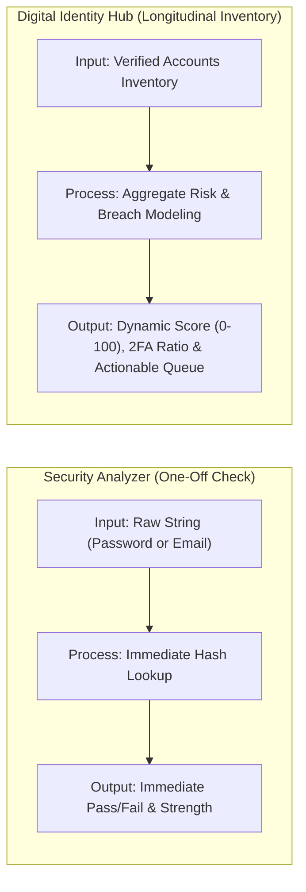
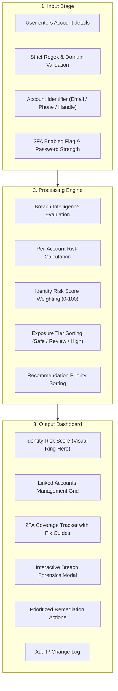
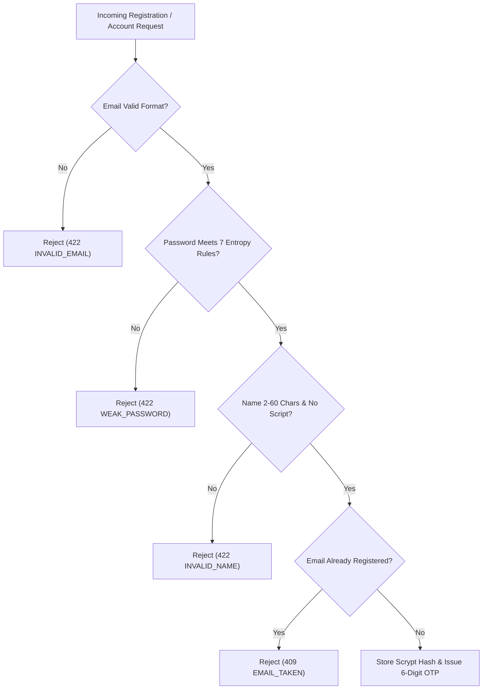
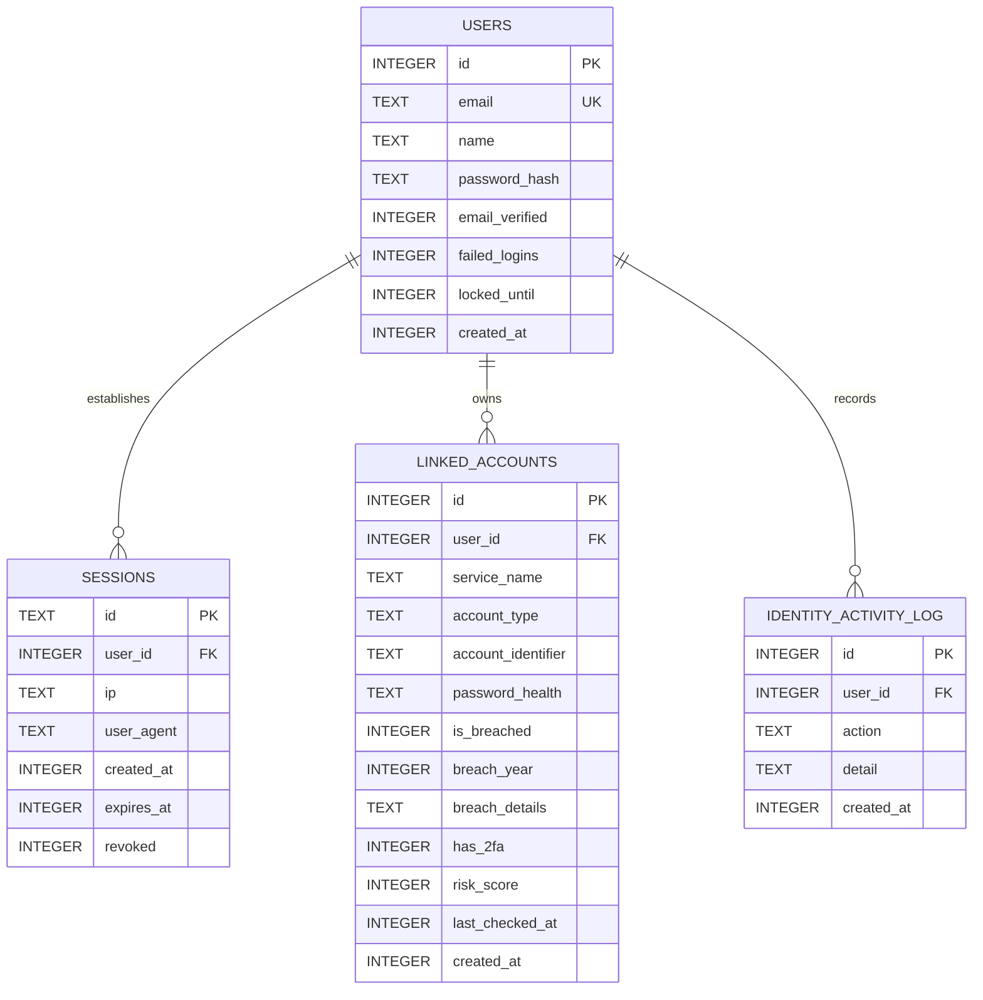

# CyberShield AI — Digital Identity Hub & Authentication Suite
## Technical Specification & Academic Viva Project Report

---

### Executive Summary

**CyberShield AI** is a proactive cybersecurity platform designed to protect end-users from identity theft, credential stuffing, and digital footprint exposure. While conventional security tools only evaluate static vulnerabilities at a single point in time, CyberShield’s **Digital Identity Hub** functions as an ongoing, centralized inventory that continuously tracks an individual’s online presence, quantifies their exposure through an **Identity Risk Score**, and offers actionable mitigation workflows.

This document details the functional specifications, cryptographic principles, database architectures, algorithmic models, and academic viva considerations for the **Digital Identity Hub** and its underlying **Authentication Suite**.

---

## 1. System Architecture: Digital Identity vs. Security Analyzer

A common architectural pitfall in cybersecurity applications is conflating instantaneous testing with longitudinal monitoring. CyberShield strictly isolates these domains:



### Architectural Comparison Matrix

| Dimension | Security Analyzer | Digital Identity Hub |
|---|---|---|
| **Core Purpose** | Run an immediate check *right now* | Track and monitor digital footprint *over time* |
| **Input Domain** | Ephemeral string typed into a check field | Authenticated user inventory of owned accounts |
| **Data Retention** | Ephemeral (zero persistence after response) | Persistent per-user inventory tied to user ID |
| **Output Deliverable** | One-off analysis & static entropy rating | Composite Identity Risk Score, 2FA ratio & prioritized queue |
| **Target Threat** | Weak password entry / single known leak | Credential stuffing across reused services, lack of 2FA |

---

## 2. Process Flow for Academic Viva & Report



* **Input**: User-provided credentials (email address, international phone, social service handle), declared 2FA status, and password health rating.
* **Process**: Automated evaluation against breach intelligence datasets, algorithmic risk scoring, and rule-based recommendation prioritization.
* **Output**: Dynamic Identity Risk Score, categorized exposure breakdown, interactive remediation guides, and real-time audit logging.

---

## 3. The Seven Pillars of Digital Identity

### 3.1. Identity Risk Score (Top Hero Display)
The **Identity Risk Score** is a normalized metric ranging from **0 to 100**, where **100 represents optimal security** and lower scores indicate severe digital exposure.

$$\text{Identity Risk Score} = 100 - \min(100, \sum \text{Penalties})$$

#### Penalty Breakdown
* **Breached Account**: $+20$ points penalty per compromised account.
* **Disabled 2FA**: $+12$ points penalty per unprotected account.
* **Weak Password**: $+15$ points penalty per vulnerable credential.
* **Reused Password**: $+10$ points penalty per repeated credential.
* **High Exposure Classification**: $+15$ points penalty for each account flagged as High Risk.
* **Unverified Master Email**: $+10$ points penalty.

A dynamic summary string is algorithmically generated based on top vulnerabilities (e.g., *"2 accounts lack 2FA, 1 password breached in 2023"*).

---

### 3.2. Linked Accounts Manager
The central repository where users manage their verified digital assets:
* **Account Types**: Emails (Work, Personal, Academic), Phone Numbers, Social Networks (Instagram, LinkedIn, X), Cloud & E-Commerce (Amazon, Google, GitHub, etc.).
* **Strict Format Enforcement**:
  * Emails must satisfy RFC-5322 regex: `^[a-zA-Z0-9._%+-]+@[a-zA-Z0-9.-]+\.[a-zA-Z]{2,}$`.
  * Phone numbers must meet ITU-T E.164 standards: `^\+?[1-9]\d{7,14}$`.
  * Service names must be standard alphanumeric strings (2–40 chars).
  * Duplicate account prevention: A user cannot add the same service and identifier twice.
* **Full CRUD Operations**: Users can Add, Edit, Delete, and trigger an on-demand Re-check for any individual account or re-evaluate all accounts in bulk.

---

### 3.3. Breach Status Forensics & "Fix This" Modal
Each linked asset displays an immediate visual state:
* `Clear`: No record of compromise in public breach repositories.
* `Exposed [Year]`: Confirmed data leak match.

Clicking on an exposed account launches the **Breach Forensics Modal**, presenting:
* Compromise Year and Source of Breach.
* Categories of Compromised Data (e.g., Passwords, IP Addresses, Phone Numbers).
* Concrete remediation checklist (Password invalidation, 2FA enforcement, session termination).

---

### 3.4. Two-Factor Authentication (2FA) Coverage
* **Protection Metric**: Displays ratio of protected assets (e.g., *"4 of 6 accounts protected with 2FA"*).
* **Visual Progress Bar**: Dynamically colored bar indicating ecosystem resilience.
* **Interactive Remediation**: Every unprotected card includes a direct action button opening step-by-step setup walkthroughs tailored to the platform (Google Authenticator, Hardware Keys, App-based TOTP).

---

### 3.5. Exposure Breakdown
An aggregated categorisation of accounts into three risk tiers:
1. **Safe**: Zero breaches, 2FA enabled, strong unique password.
2. **Need Review**: Minor vulnerability (e.g., strong password but lacking 2FA).
3. **High Risk**: Confirmed breach exposure, weak password, or critical authentication vulnerability.

---

### 3.6. Prioritized Identity Recommendations
Actionable security tasks ranked strictly by impact order:
1. **Severity 1 (Critical)**: Change compromised password on breached accounts.
2. **Severity 2 (High)**: Enable 2FA on high-value primary accounts (Email, Cloud, Social).
3. **Severity 3 (Medium)**: Replace weak credentials with entropy-tested passphrases.
4. **Severity 4 (Low)**: Prune dormant accounts no longer in active use.

---

### 3.7. Activity & Change Log (Audit Trail)
Every state change creates an immutable audit log entry:
* `"Added Instagram account to Digital Identity inventory"`
* `"Updated 2FA status to Enabled on Google"`
* `"Re-checked breach status on personal Gmail"`
* This reinforces positive user security habits and provides provable change tracking.

---

## 4. Authentication Architecture & Per-User Data Isolation

### 4.1. True vs. False Data Rejection
To ensure strict security and valid telemetry, all user inputs undergo server-side validation:



#### Mandatory Password Entropy Rules
1. Minimum 8 characters, maximum 64 characters.
2. At least one lowercase alphabetical character `[a-z]`.
3. At least one uppercase alphabetical character `[A-Z]`.
4. At least one numerical digit `[0-9]`.
5. At least one special symbol `[^A-Za-z0-9]`.
6. Zero whitespace characters.
7. Denial of dictionary passwords (`password123`, `qwerty`, etc.).
8. Prohibition of user personal tokens (cannot contain the user's name or email prefix).

---

### 4.2. Per-User Data Isolation (Clean Slate Architecture)
A primary requirement for enterprise compliance and multi-user environments is **strict tenant isolation**:

* Every linked account record is constrained by `user_id REFERENCES users(id)`.
* Every SQL query executes scoped to the session:
  ```sql
  SELECT * FROM linked_accounts WHERE user_id = ? ORDER BY created_at DESC;
  ```
* When a new user creates an account, their identity dashboard begins with **zero pre-seeded accounts**, an initial **Clean Slate Risk Score of 100/100**, and an empty audit log.
* Cross-user data leakage is structurally impossible at the relational database tier.

---

## 5. Database Schema



---

## 6. REST API Specification

### Authentication Endpoints

| Method | Route | Description | Expected Payload | Response Codes |
|---|---|---|---|---|
| `POST` | `/api/auth/signup` | Register new user | `{name, email, password}` | `201`, `422`, `409` |
| `POST` | `/api/auth/verify-otp` | Validate 6-digit OTP | `{email, otp}` | `200`, `400`, `422` |
| `POST` | `/api/auth/resend-otp` | Request fresh OTP | `{email}` | `200`, `429` |
| `POST` | `/api/auth/login` | Authenticate user session | `{email, password}` | `200`, `401`, `423` |
| `POST` | `/api/auth/logout` | Revoke active session | None (Bearer Token) | `200`, `401` |
| `GET` | `/api/auth/me` | Fetch authenticated identity | None (Bearer Token) | `200`, `401` |

### Digital Identity Endpoints

| Method | Route | Description | Expected Payload | Response Codes |
|---|---|---|---|---|
| `GET` | `/api/identity` | Get complete Identity Hub metrics | None (Bearer Token) | `200`, `401` |
| `POST` | `/api/identity/accounts` | Add new linked account | `{service_name, account_type, account_identifier, has_2fa, password_health}` | `201`, `409`, `422` |
| `PUT` | `/api/identity/accounts/<id>` | Update account details | Partial or complete fields | `200`, `404`, `422` |
| `DELETE` | `/api/identity/accounts/<id>` | Remove account from inventory | None (Bearer Token) | `200`, `404` |
| `POST` | `/api/identity/accounts/<id>/recheck`| Re-run breach evaluation | None (Bearer Token) | `200`, `404` |
| `POST` | `/api/identity/recheck-all` | Re-evaluate all user accounts | None (Bearer Token) | `200` |

---

## 7. Academic Viva Defense & Technical Questions

### Q1: Can CyberShield automatically discover every account tied to an email?
> **Answer**: **No, and it is vital to state this honestly.** There is no legal, privacy-compliant, or technically deterministic protocol on the public internet to query "all services where this email is registered." Major platforms (Google, Instagram, Amazon) treat account existence as confidential user data and protect their authentication endpoints against enumeration. CyberShield uses a **user-entered inventory model** combined with verified intelligence sources (HIBP-style breach catalogs), which represents standard enterprise posture management.

### Q2: How does the system handle password security?
> **Answer**: **Zero plaintext password retention.** CyberShield never accepts, transmits, or stores user account passwords for linked services. The system only stores an entropy rating (`strong`, `moderate`, `weak`) and a reuse boolean. For the primary CyberShield account itself, passwords are salted and hashed using **Scrypt** with secure parameterization, preventing rainbow-table and GPU-accelerated hash recovery.

### Q3: How is brute-force authentication prevented?
> **Answer**: Three layers of mitigation are deployed:
> 1. In-memory sliding-window **Rate Limiting** per IP and account.
> 2. Progressive **Account Lockout** after consecutive failed authentication attempts.
> 3. Constant-time dummy hash computation (`burn_password_check`) when a non-existent email is entered, eliminating username enumeration via timing side-channel attacks.

---

## 8. Summary of Project Files

* **Frontend**:
  * `static/index.html`: Production login, registration, and OTP verification portal.
  * `static/app.html`: Main application host shell.
  * `static/js/identity.js`: Complete dynamic rendering engine for the 7 Digital Identity features.
  * `static/css/style.css`: Responsive CSS theme featuring risk gauge meters and cards.
* **Backend**:
  * `app.py`: Flask application factory with CORS, security headers, and blueprints.
  * `db.py`: SQLite connection lifecycle and relational schema definitions.
  * `security.py`: Validation regexes, Scrypt hashing, OTP generation, and JWT sessions.
  * `services.py`: Scoring engine, breach assessment logic, and recommendation algorithms.
  * `routes_auth.py`: REST routes for signup, login, OTP verification, and session control.
  * `routes_identity.py`: REST routes for linked accounts and digital identity operations.
* **Tests**:
  * `tests/test_flow.py`: Comprehensive test suite verifying input validation, CRUD operations, and clean-slate isolation.
