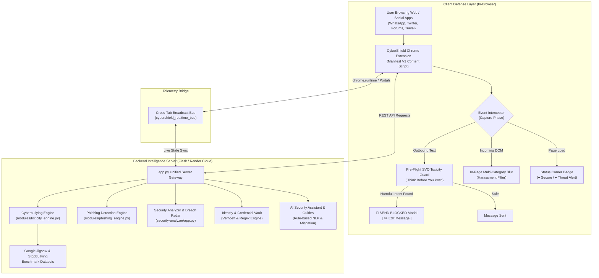

# 🛡️ CyberShield AI — Intelligent Personal Cyber Defense Platform

[](https://www.python.org/)
[](https://flask.palletsprojects.com/)
[](https://developer.chrome.com/docs/extensions/mv3/)
[](https://cybershield-ai-5bpo.onrender.com)
[](https://www.meity.gov.in/)
[](LICENSE)

> **Live Production Deployment:** [https://cybershield-ai-5bpo.onrender.com](https://cybershield-ai-5bpo.onrender.com)  
> **Interactive Extension Test Suite:** [https://cybershield-ai-5bpo.onrender.com/test-playground](https://cybershield-ai-5bpo.onrender.com/test-playground)

---

## 📌 1. Project Overview

**CyberShield AI** is an intelligent, multi-layered cyber-defense and personal protection platform designed to safeguard users against targeted cyberbullying, credential phishing, corporate credential breaches, and identity theft. By bridging **real-time client-side edge interception** (via a Chrome Extension Manifest V3) with **server-side machine learning and linguistic NLP models** (Flask REST backend), CyberShield AI delivers pre-emptive intervention rather than retrospective reporting.

---

## 🎯 2. Core Problem Breakdown & Technologies Used by Module

Conventional cybersecurity software operates passively: URLs are blocked only after being blacklisted, and toxicity filters act post-transmission after harm has already been inflicted. CyberShield AI partitions cyber threat vectors into specialized modules, each targeting a distinct problem with purpose-built technologies:

```
┌────────────────────────────────────────────────────────────────────────────────────────┐
│                               CYBERSHIELD AI PLATFORM                                  │
├──────────────────────────┬──────────────────────────┬──────────────────────────────────┤
│ 1. Digital Identity      │ 2. Security Analyzer     │ 3. Cyberbullying & Toxicity      │
│    Vault                 │    & Breach Radar        │    NLP Engine                    │
├──────────────────────────┼──────────────────────────┼──────────────────────────────────┤
│ 4. Predictive Phishing   │ 5. Browser Defense       │ 6. Unified Web Portal            │
│    & Typosquatting Radar │    Extension (Edge Guard)│    & Telemetry Hub               │
└──────────────────────────┴──────────────────────────┴──────────────────────────────────┘
```

### 2.1. Digital Identity & Credential Vault
* **Problem Addressed:**  
  Identity theft, unauthorized credential harvesting, and document fraud are pervasive when users submit unmasked identity documents (such as Aadhaar, PAN, and Passports) across unsecured online portals. Users lack offline verification methods to validate document authenticity without transmitting sensitive personally identifiable information (PII) to remote third-party servers.
* **Technologies & Components Used:**  
  * **Verhoeff Checksum Algorithm ($D_5$ Dihedral Group):** High-reliability base-10 error detection verifying 12-digit Aadhaar validity completely offline without centralized database exposure.
  * **Deterministic Regular Expression Engines:** Strict syntactic validation for Income Tax Department PAN structures (`[A-Z]{5}[0-9]{4}[A-Z]{1}`) with 5th-character applicant surname cross-referencing.
  * **Cryptographic Token Generator (PyJWT & HMAC-SHA256):** Produces ephemeral, 5-minute timed QR verification tokens (`qr_tokens`) allowing proof of identity without revealing unmasked identity strings.
  * **Dynamic DOM Masking Engine:** Client-side redaction masking all but the terminal 4 digits (`XXXX-XXXX-1234`).
  * **Scrypt Password & Secret Hashing:** Key derivation function safeguarding local vault storage against brute-force attacks.

### 2.2. Security Analyzer & Credential Breach Radar
* **Problem Addressed:**  
  Users frequently reuse weak or compromised passwords across high-value portals (banking, email, e-commerce), making them vulnerable to credential stuffing attacks. Additionally, individuals have no immediate visibility into whether their personal accounts or frequently visited enterprise domains have been compromised in public or dark-web data breaches.
* **Technologies & Components Used:**  
  * **Information Entropy Calculation (NIST SP 800-63B):** Evaluates password strength based on character set pools, Shannon entropy bits, and positional character diversity.
  * **k-Anonymity Hashing Model:** Truncates SHA-1 password hashes to 5 characters for secure external breach queries without exposing the plain password.
  * **Offline Common Passwords Dictionary:** Pre-compiled corpus of 10,000+ most frequently compromised passwords (`security-analyzer/common_passwords.txt`) for sub-millisecond offline lookup.
  * **Domain Breach Intelligence API:** Scans target domains against historical data breaches, indexing compromised fields (e.g., plaintext passwords, usernames, phone numbers) and rendering actionable security mitigation steps.
  * **Python & Flask Microservices:** Isolated microservice architecture (`security-analyzer/app.py`) allowing standalone testing and modular integration.

### 2.3. Cyberbullying & Toxicity NLP Engine
* **Problem Addressed:**  
  Traditional profanity filters rely on naive keyword blocklists that are easily circumvented by leetspeak, spacing, and colloquial slang. More critically, they fail to grasp context, confusing non-threatening hyperbole (*"I am dying of laughter"*) with targeted, dangerous harassment (*"I will kill you"*), leaving victims exposed to intimidation, social exclusion, and severe abuse.
* **Technologies & Components Used:**  
  * **Combinatorial Subject-Verb-Object (SVO) Semantic Parser:** Grammatical relationship parser identifying subject intent, violent action verbs, and direct victim targets.
  * **Google Jigsaw Toxic Comment Classification Dataset:** Benchmark corpus powering multi-category toxic trait evaluation (Severe Toxicity, Insult, Threat, Obscenity, Identity Attack).
  * **IEEE StopBullying.gov Taxonomy:** Grounded categorization for social ostracization (*"nobody likes you"*, *"make a group without her"*) and intellectual humiliation.
  * **Heuristic Intent Scorer:** Weighted scoring algorithm providing sub-millisecond classification response times (<10ms) without heavy GPU overhead.
  * **Statutory Legal Compliance Engine:** Maps detected violations directly to relevant sections of the **Indian Information Technology Act (Sec 66E, 67)** and **Indian Penal Code (Sec 500, 506, 507)** with official reporting guidance for [cybercrime.gov.in](https://cybercrime.gov.in) and Helpline **1930**.

### 2.4. Predictive Phishing & Typosquatting Radar
* **Problem Addressed:**  
  Adversaries deploy deceptive domain lookalikes, homoglyphs, and brand-squatted URLs (e.g., `paypa1.com`, `g00gle.support-login.xyz`) that mimic legitimate services. Standard blacklists only flag these URLs days or weeks after launch, by which time thousands of credentials have already been stolen.
* **Technologies & Components Used:**  
  * **Shannon Entropy Analysis:** Computes randomness in hostname characters to identify automatically generated domain names (Domain Generation Algorithms - DGAs).
  * **Levenshtein Distance & Brand Proximity Heuristics:** Calculates edit distance against top protected brands (Google, Microsoft, Amazon, SBI, PayPal) to catch character substitution and omission attacks.
  * **TLD Risk Stratification Model:** Heuristic risk-weighting engine penalizing suspicious and abuse-heavy Top-Level Domains (`.xyz`, `.top`, `.tk`, `.club`, `.work`, `.gq`).
  * **Punycode & Homoglyph Decoder:** Detects internationalized domain name (IDN) homograph attacks where Cyrillic/Greek characters substitute visually identical Latin letters.
  * **Structural URL Inspection:** Checks subdomain nesting depth, raw IP address URLs, and unencrypted transmission protocols.

### 2.5. Real-Time Browser Defense Extension (Edge Guard)
* **Problem Addressed:**  
  Web platforms lack **pre-transmission intervention**—once an abusive message or email is transmitted, the psychological, reputational, and legal consequences have occurred. Concurrently, users browsing public forums or video comment sections are routinely exposed to toxic text without warning or consent.
* **Technologies & Components Used:**  
  * **Google Chrome Extension Manifest V3:** Modern asynchronous extension architecture featuring background service workers (`background.js`) and isolated content scripts (`content.js`).
  * **Dual Event Interception (Capture Phase):** Attaches `window`-level capture phase listeners on `keydown` (`Enter`, `Ctrl+Enter`) and pointer triggers (`pointerdown`, `mousedown`, `click`) to block form submissions before SPA frameworks (React, Lexical, Angular) can dispatch them.
  * **Host Element Climbing for Rich Text Editors:** Traverses nested contenteditable DOM hierarchies (such as WhatsApp Web's Lexical composer: `footer div[contenteditable="true"]`) to reliably extract outgoing messages.
  * **Selective DOM TreeWalker API:** Rapid text node traversal that applies hardware-accelerated CSS blur filters (`filter: blur(6px)`) exclusively to abusive comments while protecting usernames, timestamps, and input controls.
  * **Dual Mount Corner Status Badge:** High-priority floating status pill (`● Secure` in emerald green or `● Threat Alert` in crimson red) attached directly to `document.documentElement` with `!important` CSS rules, guaranteeing visibility on all web layouts including canvas and game containers.
  * **HTML5 BroadcastChannel API:** Inter-tab communication bus (`cybershield_realtime_bus`) synchronizing browser extension threat events with web dashboards in real time.

### 2.6. Unified Web Application Portal & Telemetry Hub
* **Problem Addressed:**  
  Users and security administrators typically have to jump between disconnected single-purpose web tools to analyze text, inspect suspicious links, check passwords, and verify identities, resulting in a fragmented and inefficient workflow.
* **Technologies & Components Used:**  
  * **Python 3.10+ & Flask 3.0+:** Robust, lightweight REST API gateway orchestrating all backend microservices, static assets, and client sessions.
  * **Modern Vanilla JavaScript (ES6+):** Dependency-free frontend architecture ensuring fast load times and clean cross-browser execution.
  * **Responsive CSS3 Grid & Flexbox:** Cyber-themed, accessible interface with real-time risk gauges, SVG metric charts, and intuitive navigation.
  * **Gunicorn WSGI Server:** Production-grade application server deployed on Render Cloud PaaS.

---

## 🚀 3. Installation & Quick Start

Follow the steps below to set up and run the entire CyberShield AI platform locally on your machine.

### 3.1. System Prerequisites
* **Python:** Version `3.10` or higher installed ([Download Python](https://www.python.org/downloads/))
* **Browser:** Google Chrome, Brave, Microsoft Edge, or any Chromium-based browser supporting Manifest V3
* **Git:** Version control client installed ([Download Git](https://git-scm.com/))

---

### 3.2. Running the Unified Server Locally

1. **Clone the repository:**
   ```bash
   git clone https://github.com/Sam798-del/CyberShield-AI.git
   cd CyberShield-AI
   ```

2. **Create and activate a virtual environment:**
   * **On Windows (PowerShell / Command Prompt):**
     ```powershell
     python -m venv venv
     venv\Scripts\activate
     ```
   * **On Linux / macOS:**
     ```bash
     python3 -m venv venv
     source venv/bin/activate
     ```

3. **Install production dependencies:**
   ```bash
   pip install -r requirements.txt
   ```

4. **Start the backend server:**
   ```bash
   python app.py
   ```
   * The server will initialize at: `http://127.0.0.1:5000`
   * Open your browser and navigate to `http://127.0.0.1:5000` to access the main portal.

---

### 3.3. Installing the Chrome Defense Extension

1. Open your Chromium-based browser (Google Chrome, Edge, or Brave).
2. In the URL address bar, enter: `chrome://extensions/`
3. Toggle the **Developer mode** switch in the top-right corner to **ON**.
4. Click the **Load unpacked** button in the top-left toolbar.
5. In the file selection dialog, select the `extension/` directory located inside your cloned `CyberShield-AI` folder:
   ```
   <path_to_cloned_repo>/CyberShield-AI/extension/
   ```
6. The extension **CyberShield AI - Real-Time Browser Defense** will appear in your installed extensions list.
7. Click the **Extensions (puzzle piece)** icon in your browser toolbar and pin **CyberShield AI** for quick access.
8. Navigate to any website (or open the local [Interactive Test Playground](http://127.0.0.1:5000/test-playground)) to verify the green **`● Secure`** corner badge.

---

### 3.4. Running Backend Unit Tests
To verify all detection endpoints, NLP classifiers, and health checks:
```bash
python test_backend.py
```
* **Expected Output:** All 11 unit test suites pass successfully (`OK`), validating toxicity classification, URL risk scoring, AI assistant guidance, and telemetry logging.

---

## 🏛️ 4. System Architecture



---

## 🔬 5. Interactive Test Verification Suite

The repository includes a dedicated interactive verification playground (`extension/test_playground.html` or accessible at `/test-playground`) specifically created to demonstrate each defense mechanism:

| Test Stage | Feature Tested | Action & Input | Expected Behavioral Outcome |
| :---: | :--- | :--- | :--- |
| **Stage 1** | **Phishing Radar** | Click sample legitimate vs. spoofed URLs (`paypa1-security.xyz`) | System calculates risk score; malicious domains trigger a red banner and update the corner badge to **`● Threat Alert`**. |
| **Stage 2** | **Inbound Toxic Blurring** | View sample comments containing slurs, harassment, and threats | Content is automatically masked with `blur(6px)` and red warning shields; clicking reveals text safely. |
| **Stage 3** | **Selected Text Inspection** | Highlight any paragraph on page and open extension popup | Clicking *"💬 Toxic Text"* retrieves instant severity scores and flagged intents. |
| **Stage 4** | **Password Entropy** | Type credentials in sample login fields | Visual strength meter evaluates NIST entropy bits, dictionary vulnerabilities, and character distribution. |
| **Stage 5** | **Outbound Message Blocker** | Type `"I will kill you"` in the composer and press **Enter** or click **Send** | Event is trapped in DOM capture phase: transmission is **halted**, the composer is locked, and the **🛑 SEND BLOCKED** modal opens with Indian IT Act legal warnings. |

---

## 📂 6. Repository File Structure

```
CyberShield-AI/
├── app.py                                    # Central unified Flask REST gateway & routes
├── requirements.txt                          # Production Python dependencies (Flask, Gunicorn, CORS)
├── test_backend.py                           # 11 automated unit test suites for API verification
├── vercel.json                               # Vercel deployment configuration
├── run_server.bat                            # Quick-start script for Windows server execution
├── run_security_analyzer.bat                 # Standalone script for Security Analyzer microservice
│
├── modules/                                  # Core AI & Detection Modules
│   ├── toxicity_engine.py                    # SVO Grammar & Jigsaw Toxicity Engine
│   ├── phishing_engine.py                    # Domain & URL Heuristic Phishing Engine
│   └── datasets/
│       └── jigsaw_cyberbullying_corpus.json  # Benchmark dataset annotations
│
├── extension/                                # Chrome Browser Defense Extension (Manifest V3)
│   ├── manifest.json                         # Extension manifest declaration & permissions
│   ├── test_playground.html                  # 5-Stage interactive test suite & outbound demo
│   ├── scripts/
│   │   ├── content.js                        # Injected DOM guard, Outbound blocker, Corner badge
│   │   └── background.js                     # Service worker, offline heuristics, domain radar
│   ├── popup/
│   │   ├── popup.html                        # Extension popup UI & live status gauges
│   │   ├── popup.js                          # Extension controller & telemetry sync
│   │   └── popup.css                         # Extension design styling
│   └── assets/                               # Extension icons (16, 48, 128px) & brand logo
│
├── frontend/                                 # Web Application Portals
│   ├── index.html                            # Main landing page & feature overview
│   ├── pages/
│   │   ├── dashboard.html                    # Threat telemetry dashboard & live activity
│   │   ├── cyberbullying-detection.html      # Standalone text toxicity scanner
│   │   ├── phishing-detection.html           # Standalone URL & domain phishing scanner
│   │   ├── digital-identity.html             # Identity vault & credential manager
│   │   ├── security-analyzer.html            # Password & domain breach lookup
│   │   ├── security-report.html              # AI-generated security posture report
│   │   ├── guide.html                        # Cybersecurity education center
│   │   ├── login.html                        # User login & session authentication
│   │   └── settings.html                     # Platform preferences & threshold controls
│   ├── js/
│   │   ├── state.js                          # Cross-tab broadcast telemetry bridge
│   │   ├── tour.js                           # Interactive feature onboarding tour
│   │   ├── utils.js                          # Client NLP heuristics & formatting helpers
│   │   ├── api.js                            # Centralized REST API fetch wrapper
│   │   ├── app.js                            # Dashboard controller & chart renderers
│   │   └── navigation.js                     # Dynamic portal navigation
│   ├── css/                                  # Modular stylesheet definitions
│   └── assets/                               # Web icons & high-resolution logos
│
├── security-analyzer/                        # Standalone Breach & Credential Analyzer Service
│   ├── app.py                                # Analyzer Flask microservice
│   ├── test_analyzer.py                      # Analyzer test suite
│   ├── requirements.txt                      # Analyzer dependencies
│   └── common_passwords.txt                  # Dictionary of breached passwords
│
└── desktop/                                  # PyQt Desktop Application Client
    ├── main.py                               # Desktop app entrypoint
    └── pages/                                # Desktop PyQt view controllers
```

---

## 📡 7. REST API Reference

| Endpoint | Method | Description | Sample Request Payload | Key Response Fields |
| :--- | :---: | :--- | :--- | :--- |
| `/api/health` | `GET` | Service health status check | _None_ | `status: "online"`, `version` |
| `/api/detect/cyberbullying` | `POST` | SVO toxicity & intent analysis | `{"text": "I will kill you"}` | `toxicity_score: 100`, `toxicity_level`, `flagged_intents`, `safety_actions` |
| `/api/detect/phishing` | `POST` | Domain & URL heuristic scan | `{"text": "https://paypa1-security.xyz"}` | `risk_score: 85`, `verdict: "PHISHING"`, `flags` |
| `/api/analyzer/password` | `POST` | Password breach & entropy check | `{"password": "password123"}` | `strength`, `entropy_score`, `pwned_count` |
| `/api/analyzer/leak` | `POST` | Domain data breach audit | `{"domain": "canva.com"}` | `found: true`, `breaches: [...]` |
| `/api/guide/ask` | `POST` | AI Security Assistant inquiry | `{"question": "How do I report harassment?"}` | `answer`, `legal_remedies` |
| `/api/settings` | `GET/POST` | Platform sensitivity thresholds | `{"threshold": 35}` | `settings`, `status: "saved"` |

---

## ⚖️ 8. Legal & Statutory Alignment

CyberShield AI bridges algorithmic threat detection with statutory cyber law:
* **Information Technology Act, 2000 (India):**
  * **Section 66D:** Punishment for cheating by personation by using computer resource (Credential Phishing).
  * **Section 66E:** Violation of privacy through publishing private images without consent.
  * **Section 67 / 67A:** Publishing obscene, defamatory, or sexually explicit content in electronic form.
* **Indian Penal Code (IPC):**
  * **Section 500:** Punishment for criminal defamation.
  * **Section 506 / 507:** Criminal intimidation and threats of harm conveyed via anonymous communication.
* **Statutory Reporting Integration:** Direct evidentiary export and guidance for official reporting via the National Cyber Crime Reporting Portal ([cybercrime.gov.in](https://cybercrime.gov.in)) and National Cyber Helpline **1930**.

---

## 📄 9. License

This project is licensed under the **MIT License** — see the [LICENSE](LICENSE) file for complete details.
