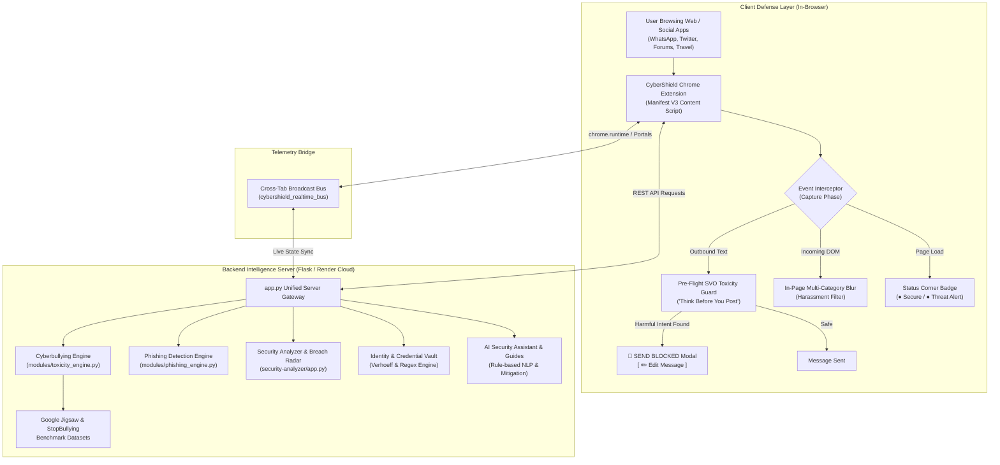

# 🛡️ CyberShield AI — Intelligent Personal Cyber Defense Platform

[](https://www.python.org/)
[](https://flask.palletsprojects.com/)
[](https://developer.chrome.com/docs/extensions/mv3/)
[](https://cybershield-ai-5bpo.onrender.com)
[](https://www.meity.gov.in/)
[](LICENSE)

> **Live Production Deployment:** [https://cybershield-ai-5bpo.onrender.com](https://cybershield-ai-5bpo.onrender.com)  
> **Interactive Extension Test Suite:** [https://cybershield-ai-5bpo.onrender.com/test-playground](https://cybershield-ai-5bpo.onrender.com/test-playground)

---

## 📌 1. Project Insight & Executive Summary

**CyberShield AI** is an end-to-end, real-time personal cyber defense system designed to counter modern digital threats: **targeted cyberbullying and digital harassment, credential phishing and domain spoofing, identity theft, and corporate credential leakage**.

### The Core Problem
Conventional web filters and security tools are **passive and retrospective**: they block malicious domains only after they are blacklisted, and they rely on primitive keyword blocklists that are easily bypassed by slang, spacing, leetspeak, or subtle phrasing. Furthermore, social media platforms lack **pre-transmission intervention**—once a harmful or threatening message is sent, the psychological and legal damage is already done.

### The CyberShield AI Solution
CyberShield AI bridges client-side active protection with server-side AI intelligence:
1. **Pre-Transmission Outbound Guard ("Think Before You Post"):** An in-browser behavioral interceptor that analyzes outbound comments, tweets, and chat messages in the DOM capture phase (<2ms). If violent threats, death commands, misogynistic slurs, or harassment are detected, the transmission is **instantly blocked** before leaving the client browser, prompting an interactive **[ ✏️ Edit Message ]** dialog with statutory legal warnings under the **Indian IT Act (Sec 66E/67)** and **IPC (Sec 506/507)**.
2. **Deep Semantic Intent NLP Classifier:** Combines a **Combinatorial Subject-Verb-Object (SVO) semantic grammar engine** with the **Google Jigsaw Toxic Comment Classification** and **IEEE StopBullying.gov** benchmark corpora.
3. **Zero-Day Phishing & Typosquatting Radar:** Real-time domain heuristic scanner that analyzes Shannon entropy, character substitution (e.g. `paypa1.com`), brand impersonation, and high-risk TLDs.
4. **Zero-Knowledge Digital Identity Vault:** Verifies government-issued identification numbers (Aadhaar via **Verhoeff checksum**, PAN cards, Passports, Driving Licences) offline with privacy masking and cryptographic QR tokens.
5. **Real-Time Threat Telemetry & Breach Radar:** Cross-tab event bus (`BroadcastChannel`) connecting browser extension events with web portal dashboards, credential breach intelligence (HaveIBeenPwned API), and actionable incident response recommendations.

---

## 🏛️ 2. High-Level System Architecture



---

## 👥 3. Team Contribution & Module Ownership Matrix

CyberShield AI was engineered as a collaborative B.Tech CST final year capstone project at **Usha Mittal Institute of Technology (UMIT), SNDT Women's University, Mumbai**.

| Team Member | Role | Core Assigned Deliverables | Primary Files Owned & Maintained |
| :--- | :--- | :--- | :--- |
| **Shreya** <br/> (`sy432` / `Sam798-del`) | **Lead NLP & Extension Architect** | • Cyberbullying & Toxicity Engine (SVO Grammar & Jigsaw Corpus)<br/>• Manifest V3 Chrome Defense Extension<br/>• Outbound Message Interceptor ("Think Before You Post")<br/>• WhatsApp Web & SPA DOM Injection Bridge<br/>• Dynamic Status Corner Badge (`● Secure` / `● Threat Alert`)<br/>• Interactive Test Playground Suite<br/>• Render Cloud Deployment Pipeline | `modules/toxicity_engine.py`<br/>`modules/datasets/jigsaw_cyberbullying_corpus.json`<br/>`extension/manifest.json`<br/>`extension/scripts/content.js`<br/>`extension/scripts/background.js`<br/>`extension/popup/` (`popup.html`, `js`, `css`)<br/>`extension/test_playground.html`<br/>`frontend/pages/cyberbullying-detection.html`<br/>`test_backend.py` |
| **Kaveri** <br/> (`kaveribartakke2702`) | **Authentication & Identity Architect** | • User Sign-Up, Login & Scrypt Password Hashing<br/>• OTP Email Verification Engine (TLS SMTP)<br/>• Session Management & PyJWT Token Lifecycle<br/>• Government Identity Document Formats (Aadhaar Verhoeff, PAN, Passport)<br/>• Privacy Masking & Timed QR Verification Tokens<br/>• Identity Trust Score Calculation Algorithm | `routes_auth.py`<br/>`routes_identity.py`<br/>`routes_profile.py`<br/>`security.py`<br/>`services.py`<br/>`identity_docs.py`<br/>`db.py`<br/>`frontend/pages/digital-identity.html`<br/>`frontend/pages/login.html`<br/>`desktop/pages/` (`login`, `signup`, `settings`) |
| **Neeraja** <br/> (`neerajashinde7`) | **Security Analyzer & Incident Architect** | • Security Analyzer Service & Credential Leak Radar<br/>• Password Entropy Evaluator & HaveIBeenPwned Integration<br/>• Real-Time Threat Telemetry State (`state.js`)<br/>• Inter-Process BroadcastChannel Bridge (`cybershield_realtime_bus`)<br/>• Interactive Feature Tour & Onboarding Guide (`tour.js`)<br/>• UI Dashboard Analytics & Incident Table | `security-analyzer/app.py`<br/>`security-analyzer/test_analyzer.py`<br/>`security-analyzer/common_passwords.txt`<br/>`frontend/pages/security-analyzer.html`<br/>`frontend/pages/security-report.html`<br/>`frontend/pages/dashboard.html`<br/>`frontend/js/state.js`<br/>`frontend/js/tour.js`<br/>`frontend/assets/logo.png` |

---

## 🔬 4. Deep-Dive Feature Modules

### 4.1. Cyberbullying & Toxicity NLP Engine
* **Combinatorial SVO Grammar:** Unlike keyword filters, parses subject intents, violent verbs, and target direct objects. Detects:
  * Direct violent assault & weapon harm (`I will kill you with hammer`, `murder you`, `slit your throat`).
  * Death commands & suicide incitement (`you should die`, `die slut here`, `go die alone`).
  * Universal social exclusion (`no one likes you`, `nobody wants you around`, `make a group without her`).
  * Misogynistic slurs & severe profanity (`slut`, `whore`, `bitch`, `cunt`).
  * Body shaming, cyberstalking, and malicious defamation/doxing.
* **Corpus Grounding:** Google Jigsaw Toxic Comment Classification Dataset and IEEE StopBullying taxonomy (`modules/datasets/jigsaw_cyberbullying_corpus.json`).
* **Statutory Compliance:** Generates immediate evidentiary guidance under **Indian IT Act Section 66E / 67** and **IPC Sections 500 / 506 / 507** (cybercrime.gov.in / 1930 helpline).

### 4.2. Chrome Extension & Outbound Blocker ("Think Before You Post")
* **Dual Interception (Keyboard & Pointer):**
  * `keydown` (Enter / Ctrl+Enter) captured in `window` capture phase before SPA frameworks (React / Lexical) consume the event.
  * `pointerdown`, `mousedown`, and `click` captured on submit buttons to prevent React from dispatching messages prior to evaluation.
* **WhatsApp Web & Rich Text Host Climbing:** Resolves nested DOM structures (`<div contenteditable="true" role="textbox">`) and climbs to the root composer to extract the full message payload.
* **Dynamic Corner Badge:**
  * Clean, safe pages: Displays **`● Secure`** in emerald green (`#10b981`).
  * Malicious domains, data breaches, or blurred toxic comments: Instantly updates to **`● Threat Alert`** in alert red (`#ef4444`).
* **Real-Time Live Typing Guidance:** In-field floating badge alerting the user *as they type* if harmful language is detected.

### 4.3. Predictive Phishing & Domain Threat Radar
* **Heuristic Feature Scoring:**
  * Shannon entropy calculation on hostnames to flag algorithmic DGA domains.
  * Typosquatting and brand spoofing patterns (`paypa1`, `g00gle`, `micros0ft`, `app1e`, `amaz0n`).
  * High-risk suspicious Top-Level Domains (`.xyz`, `.top`, `.tk`, `.club`, `.work`, `.gq`).
  * IP address URL inspection, excess subdomains, and unencrypted HTTP detection.

### 4.4. Digital Identity & Credential Vault
* **Aadhaar Verhoeff Checksum:** Offline Dihedral Group $D_5$ mathematical validation proving mathematical validity without central server leakage.
* **PAN Card Syntactic & Semantic Match:** Validates Income Tax Department format (`AAAAA9999A`) and verifies that the 5th character matches the applicant's first or last name initial.
* **Cryptographic QR Tokens:** Creates 5-minute timed verification tokens (`qr_tokens`) allowing users to prove credential validity without revealing unmasked document numbers.

### 4.5. Security Analyzer & Incident Telemetry Bridge
* **Password Breach Evaluator:** Scans passwords against known breach datasets (k-Anonymity model) and standard common dictionary passwords (`security-analyzer/common_passwords.txt`).
* **Real-Time Cross-Tab Telemetry:** Emits custom events across browser tabs via `BroadcastChannel("cybershield_realtime_bus")`. When the Chrome extension blocks a threat, the web dashboard updates its threat count in real time without page reload.

---

## 📂 5. Repository File Structure & Audit Status

```
CyberShield-AI/
├── app.py                                    # Central unified Flask server gateway & routes [Clean / Active]
├── requirements.txt                          # Production Python dependencies [Clean / Active]
├── test_backend.py                           # 11 automated unit test suites [All Passing]
├── vercel.json                               # Vercel deployment specification
├── run_server.bat                            # Local Windows launch script
├── run_security_analyzer.bat                 # Security Analyzer startup script
│
├── modules/                                  # Core AI & NLP Classification Modules
│   ├── toxicity_engine.py                    # SVO Grammar & Jigsaw Toxicity Engine (Shreya)
│   ├── phishing_engine.py                    # Domain & URL Heuristic Phishing Engine
│   └── datasets/
│       └── jigsaw_cyberbullying_corpus.json  # Benchmark dataset annotations
│
├── extension/                                # Chrome Browser Defense Extension (Manifest V3)
│   ├── manifest.json                         # Extension manifest configuration
│   ├── test_playground.html                  # 5-Stage interactive test suite & outbound demo
│   ├── scripts/
│   │   ├── content.js                        # Injected DOM guard, Outbound blocker, Corner badge
│   │   └── background.js                     # Service worker, offline NLP engine, domain radar
│   ├── popup/
│   │   ├── popup.html                        # Extension popup UI & live status gauges
│   │   ├── popup.js                          # Extension controller & telemetry sync
│   │   └── popup.css                         # Extension design styling
│   └── assets/                               # Extension icons (16, 48, 128px) & brand logo
│
├── frontend/                                 # Web Application Portals
│   ├── index.html                            # Main landing page & feature overview
│   ├── pages/
│   │   ├── dashboard.html                    # Threat telemetry dashboard & live activity
│   │   ├── cyberbullying-detection.html      # Standalone text toxicity scanner
│   │   ├── phishing-detection.html           # Standalone URL & domain phishing scanner
│   │   ├── digital-identity.html             # Identity vault & credential manager
│   │   ├── security-analyzer.html            # Password & domain breach lookup
│   │   ├── security-report.html              # AI-generated security posture report
│   │   ├── guide.html                        # Cybersecurity education center
│   │   ├── login.html                        # User login & session authentication
│   │   └── settings.html                     # Platform preferences & threshold controls
│   ├── js/
│   │   ├── state.js                          # Cross-tab broadcast telemetry bridge
│   │   ├── tour.js                           # Interactive feature onboarding tour
│   │   ├── utils.js                          # Client NLP heuristics & formatting helpers
│   │   ├── api.js                            # Centralized REST API fetch wrapper
│   │   ├── app.js                            # Dashboard controller & chart renderers
│   │   └── navigation.js                     # Dynamic portal navigation
│   ├── css/                                  # Modular stylesheet definitions
│   └── assets/                               # Web icons & high-resolution logos
│
├── security-analyzer/                        # Standalone Breach & Credential Analyzer Service
│   ├── app.py                                # Analyzer Flask service (Neeraja)
│   ├── test_analyzer.py                      # Analyzer test suite
│   ├── requirements.txt                      # Analyzer dependencies
│   └── common_passwords.txt                  # Dictionary of breached passwords
│
└── desktop/                                  # PyQt Desktop Application Client
    ├── main.py                               # Desktop app entrypoint
    └── pages/                                # Desktop PyQt view controllers
```

---

## 🚀 6. Installation & Quick Start

### 6.1. Prerequisites
* Python 3.10 or higher
* Google Chrome, Brave, or Microsoft Edge (Chromium-based browser)
* Git

### 6.2. Running the Unified Web Server Locally

1. **Clone the repository:**
   ```bash
   git clone https://github.com/Sam798-del/CyberShield-AI.git
   cd CyberShield-AI
   ```

2. **Create and activate a virtual environment:**
   ```bash
   # Windows
   python -m venv venv
   venv\Scripts\activate

   # Linux / macOS
   python3 -m venv venv
   source venv/bin/activate
   ```

3. **Install production dependencies:**
   ```bash
   pip install -r requirements.txt
   ```

4. **Launch the platform:**
   ```bash
   python app.py
   ```
   * Open your browser and navigate to: `http://127.0.0.1:5000`

---

### 6.3. Installing the Chrome Defense Extension

1. Open Google Chrome and navigate to `chrome://extensions/`.
2. In the top-right corner, enable **Developer mode**.
3. Click the **Load unpacked** button in the top-left corner.
4. Select the `extension/` directory inside your cloned `CyberShield-AI` folder.
5. CyberShield AI is now running. Pin the extension to your toolbar.
6. Open any website (e.g. WhatsApp Web, Twitter, or the [Live Test Playground](https://cybershield-ai-5bpo.onrender.com/test-playground)) to experience real-time protection.

---

## 🧪 7. Testing & Verification

### 7.1. Automated Backend Unit Tests
Execute the backend test suite:
```bash
python test_backend.py
```
* **Coverage:** Validates API health check, AI assistant guidance endpoints, configuration persistence, and cyberbullying detection payloads.

### 7.2. Interactive Verification Suite (Test Playground)
Navigate to `/test-playground` in your browser (or visit [https://cybershield-ai-5bpo.onrender.com/test-playground](https://cybershield-ai-5bpo.onrender.com/test-playground)):

| Stage | Test Name | Expected Result |
| :---: | :--- | :--- |
| **Test 1** | **Domain Phishing Radar** | Verifies legitimate vs. spoofed domain detection in real time. |
| **Test 2** | **In-Page Text Blurring** | Automatically detects offensive comments and applies red warning shields with click-to-reveal. |
| **Test 3** | **Popup Selected Text Scan** | Highlight text, open extension popup, and click *"💬 Toxic Text"* for instant severity verdicts. |
| **Test 4** | **Password Field Entropy** | Type in a password input to see real-time character diversity and entropy guidance. |
| **Test 5** | **Outbound Message Blocker** | Type `"I will kill you"`, press Enter or click *"Send Comment"* ➔ Message is **instantly blocked**, transmission halted, and the **[ ✏️ Edit Message ]** modal appears. |

---

## 📡 8. REST API Reference

| Endpoint | Method | Description | Sample Request Payload | Key Response Fields |
| :--- | :---: | :--- | :--- | :--- |
| `/api/health` | `GET` | Service health status check | _None_ | `status: "online"`, `version` |
| `/api/detect/cyberbullying` | `POST` | SVO toxicity & intent analysis | `{"text": "I will kill you"}` | `toxicity_score: 100`, `toxicity_level`, `flagged_intents`, `safety_actions` |
| `/api/detect/phishing` | `POST` | Domain & URL heuristic scan | `{"text": "https://paypa1-security.xyz"}` | `risk_score: 85`, `verdict: "PHISHING"`, `flags` |
| `/api/analyzer/password` | `POST` | Password breach & entropy check | `{"password": "password123"}` | `strength`, `entropy_score`, `pwned_count` |
| `/api/analyzer/leak` | `POST` | Domain data breach audit | `{"domain": "canva.com"}` | `found: true`, `breaches: [...]` |
| `/api/guide/ask` | `POST` | AI Security Assistant inquiry | `{"question": "How do I report harassment?"}` | `answer`, `legal_remedies` |
| `/api/settings` | `GET/POST` | Platform sensitivity thresholds | `{"threshold": 35}` | `settings`, `status: "saved"` |

---

## ⚖️ 9. Legal & Statutory Alignment

CyberShield AI contextualizes all threat detections with actionable statutory reporting guidance under Indian legislation:
* **Information Technology Act, 2000:**
  * **Section 66D:** Cheating by personation using computer resources (Phishing).
  * **Section 66E:** Violation of privacy through publishing private images without consent.
  * **Section 67 / 67A:** Publishing obscene, defamatory, or sexually explicit content.
* **Indian Penal Code (IPC):**
  * **Section 500:** Defamation and smear campaigns.
  * **Section 506 / 507:** Criminal intimidation and threats of harm by anonymous communication.
* **National Cyber Crime Reporting:** Integration hooks for official reporting via [cybercrime.gov.in](https://cybercrime.gov.in) and National Helpline **1930**.

---

## 📄 10. License

This project is licensed under the **MIT License** — see the [LICENSE](LICENSE) file for complete details.
